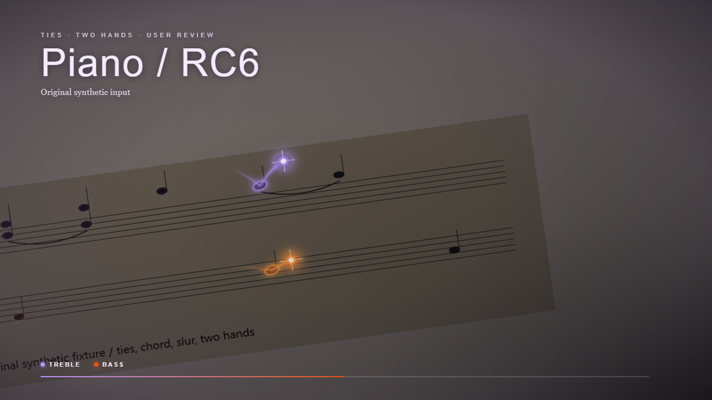

<div align="center">

# 🎹 Piano Remotion

**让乐谱随音乐跳起来。**

双手音符跳跃 · 发光轨迹 · 和弦高亮 · 跟谱运镜


[快速开始](#快速开始) · [素材输入](#你可以提供什么) · [制作流程](#从素材到成片) · [常见问题](#使用建议与常见问题) · [下载 V1.1.0](https://github.com/Fallonwong/piano-remotion/releases/tag/v1.1.0)

</div>



> 将钢琴乐谱变成跟随音乐演奏的动态画面。先确认谱面，再确认画面与试听，让每一次修改都有清晰的依据。

**V1.1.0 更新**：新增横竖屏与动态焦点、制作前配置、原谱范围检查、演奏时间映射和逐音复核。不同素材的准备方式与处理链路见下文；自动音高和改编判定仍属实验能力。详见 [版本说明](RELEASE_NOTES.md)、[实现状态与限制](references/upgrade-status.md)、[制作规范](references/production.md)。

## 为钢琴乐谱而设计

Piano Remotion 是一个基于 Remotion 的专项 Agent Skill。它把乐谱整理、音频接入、画面预览与视频导出连接起来，让 Codex、WorkBuddy 等 Agent 按同一套流程制作钢琴跟谱视频。

- **双手分轨**：左右手以独立光点和轨迹跟随演奏，和弦中的音符同步高亮。
- **完整乐句**：区分延音线、圆滑线与符杠，保留音符时值、休止符和声部关系。
- **先看再出片**：谱面确认、关键帧与试听确认，两次停顿把决定权交给你。
- **优先复用环境**：发现已有 Remotion、排谱工具和音源，按任务需要补齐能力。
- **通用素材边界**：个人装饰默认关闭，作品素材由你提供。

适合钢琴教学片段、曲谱演示、练习分享，以及带有音符跳跃效果的音乐视频。

## 快速开始

### 1. 安装 Skills

先安装官方 Remotion Skill，再安装 Piano Remotion。已经安装的部分可以直接复用。

```sh
npx skills add remotion-dev/skills --skill remotion-best-practices
npx skills add Fallonwong/piano-remotion --skill piano-remotion
```

按安装器提示选择 Agent 和安装范围。手动安装可下载 [V1.1.0 完整包](https://github.com/Fallonwong/piano-remotion/releases/tag/v1.1.0)，解压后保留整个 `piano-remotion/` 目录，放入当前 Agent 的 Skill 目录。

安装后开启新对话，确认 Agent 能读取两个 Skill。使用不支持 `$名称` 调用的 Agent 时，直接让它读取对应目录下的 `SKILL.md`。

### 2. 提供素材，说出目标

可以附上文件，也可以提供 Agent 有权读取的本地路径。把下面的占位内容换成你的素材：

```text
使用 $piano-remotion，先读取官方 $remotion-best-practices。

我的素材：<PDF / MusicXML / MIDI / SVG / MP3 / 乐谱图片的路径>。
请制作一支钢琴跟谱视频，保留原版双手跳跃、发光轨迹、音符高亮和运镜。
优先复用当前工程 <工程路径，如有> 及现有工具，个人装饰关闭。

先展示原谱与重排谱的逐小节对照、修订差异和疑点，停下来等我确认。
我确认谱面后，再展示真实关键帧、短试听和连音动态，第二次等我确认。
确认后导出 MP4，并检查音频和画面同步。

有录音就使用原录音；没有录音时，先检查可用钢琴音源并让我试听。
需要安装工具或下载音源时，先说明方案和大小。
```

### 3. 在两个关键节点确认

**第一次看谱**：核对旋律、节奏、左右手、和弦与连线。发现问题时指出小节和位置，Agent 会展示修改前后的差异。

**第二次看画面、听声音**：确认清晰度、镜头、音符运动、钢琴音色与同步，再导出完整视频。

更多输入场景见 [提示词示例](examples/agent-prompts.md)，安装细节见 [使用说明](README_使用说明.md)。

## 你可以提供什么

| 素材 | 推荐处理方式 |
| --- | --- |
| **MusicXML** | 优先复用结构化音高、节奏、声部和记谱信息，再排版并建立坐标映射。 |
| **MIDI** | 读取音符与速度信息，补充谱面排版、左右手分配和坐标。 |
| **SVG + timeline JSON** | 使用同一次排版产生的谱面与时间轴，直接接入动效。 |
| **SVG** | 保留原谱符号，补充对应的演奏时间和音符坐标。 |
| **MP3 / 演奏录音** | 有对应乐谱时接入原音频并建立时间映射；只有录音时需另行准备乐谱或复用已安装的转谱工具，当前内置分析不负责完整复调转谱。 |
| **PDF / 五线谱图片** | 优先调用已有专业 OMR 工具，生成可编辑乐谱，再逐小节对照原件。 |
| **简谱图片** | 先确认调号、八度、节拍及连线，再整理成可排版、可同步的数据。 |
| **多种素材组合** | 每个环节选择信息最完整的来源，只补缺少的部分。 |

素材不必一次准备齐全。Agent 会先发现已有工具，再给出与当前素材对应的处理路径。基础动画使用 Node.js 与 Remotion；Python、OMR 和其他 CLI 按实际任务需要接入。

## 哪些素材更容易得到可靠结果？

**接受生成钢琴配乐，优先提供已校订的 MusicXML；需要保留原演奏，优先提供同一改编、同一选段的 MusicXML + MP3。**

MusicXML 能直接提供音高、节奏、声部和连线。谱面与音频来源一致，可以减少识谱、版本核对和时间匹配中的不确定性。以下顺序根据当前实现需要补齐的环节给出，尚无覆盖各类真实素材的成功率统计，因此不标注成功率百分比。

| 推荐顺序 | 素材组合 | 适用场景与制作要点 |
| --- | --- | --- |
| **优先：结构化谱面生成配乐** | **已校订 MusicXML，接受由该谱生成全曲钢琴音频** | 适合曲谱演示、教学和练习分享。复用现有采样钢琴音源，使配乐与排谱来自同一份音乐数据；确认谱面、音色和最终试听。 |
| **优先：保留原演奏** | **已校订 MusicXML + 完整对应的 MP3**，可附原 PDF 供对照 | 适合已有演奏录音的作品。先核对改编、选段、重复和段落顺序，再建立实际演奏时间映射；相同 BPM 不能替代逐音同步核对。 |
| **可以做：先确认左右手和声部** | **MIDI + 明确的左右手/声部归属**，可附同次演奏录音及对应谱面 | 可读取音高、音符时值与速度信息；需补齐记谱排版、小节归属和坐标。单独的 MIDI 不恢复原谱的等音拼写、连线等全部记谱信息，也不自动对齐另一份 MP3。 |
| **可以做：先识谱并核对音符** | **完整 PDF / 五线谱图片**，可附同版 MP3，或接受生成配乐 | 优先复用已安装 OMR，生成可编辑谱后核对调号、临时升降号、还原号、和弦与连线，再进入同步。清晰、完整、平正的原件更适合此路径。 |
| **需补充来源：仅录音** | **只有 MP3** | 保留原音频；先补充对应乐谱，或确认现有转谱工具可用。内置频谱/起音分析提供核对线索和时间候选，不承诺从录音直接恢复完整双手乐谱。 |
| **先明确版本关系** | **同曲但不同改编的谱面与录音，或全谱与选段混用** | 先明确采用哪个版本、原谱对应小节及重复顺序，再制作。增加多份不对应的素材不会自动提高可靠性。 |

已经有排版数据时，也可以提供**同一次排版的 SVG + 已核验时间轴 + 对应源谱和音频**，复用既有成果。需要检查坐标、音乐内容与演奏映射是否属于同一版本；只有 SVG 或一个标记为“通过”的 JSON，不能证明同步正确。

### 不同输入的完成把握与实际链路

这里的“成功”指**音乐内容、演奏同步及最终 MP4 均完成验证**。生成了一个预览、XML 结构通过或渲染命令正常退出，都不单独计为制作成功。当前尚未按下面各类真实输入积累完整任务样本，**各路径的实测成功率均为待统计**。下表直接说明每种素材还要先做什么，不用未经实测的百分比估计结果。

| 用户提供的素材 | 能不能做，还需要什么 | 基于现有 Skill 的处理链路 | 影响结果的主要条件 |
| --- | --- | --- | --- |
| **只有 MP3** | **建议先补对应乐谱** | 解码检查 → 复用可用的外部转谱能力或补充谱面 → 核对 MusicXML/MIDI → 建立符号事件和排版 → 对齐原录音 → 复核与渲染 | Skill 不内置完整双手音频转谱；缺少转谱能力或谱面时停在准备阶段，不能仅凭起音分析生成准确乐谱。 |
| **MP3 + PDF／五线谱图片** | **可以做，先把图片里的音符识别并核对好** | 原谱页面检查 → 可用 OMR/识谱能力生成 MusicXML → 原谱范围与逐小节核对 → 符号事件、排版坐标 → 原音频时间候选与分段映射 → 复核与渲染 | 原件清晰、识谱工具可用、谱面与录音同版同段；识谱错误和录音局部变速分别处理。 |
| **MP3 + 已校订 MusicXML** | **想保留原录音，最推荐这组** | XML 结构检查 → 显式播放顺序与符号事件 → 排版坐标 → 原录音频谱/起音候选 → 经核对的分段或逐音映射 → 复核与渲染 | 无需从图片或音频重新识谱；仍需核对同版、反复与实际演奏时间。附 PDF 时继续做原谱对照。 |
| **MP3 + MIDI** | **可以做，先确认左右手、声部和录音是否对应** | MIDI 音符/速度解析 → 明确声部、左右手和小节归属 → 补记谱及排版坐标 → 与 MP3 核对内容和时间 → 演奏映射 → 复核与渲染 | MIDI 速度信息不代表与另一份 MP3 自动同步；跨手、多声部和记谱细节需明确。 |
| **只有已校订 MusicXML，接受生成配乐** | **不需要保留原录音，最推荐这组** | XML 检查与谱面确认 → 符号事件、排版 → 已有采样钢琴音源导出全曲 → 检查前导静音与尾音、建立时间映射 → 复核与渲染 | 同一份谱同时用于排版和生成配乐，减少版本差异；现有音源须可用，导出音频仍需试听和同步核对。 |
| **只有 PDF／五线谱图片，接受生成配乐** | **可以做，先识谱和校对，再生成配乐** | 页面检查 → 可用 OMR/识谱能力生成并核对 MusicXML → 接“MusicXML 生成配乐”路径 | 主要先解决识谱质量；没有原录音时无需匹配另一份演奏，但识谱结果不能自动视为原谱真值。 |
| **SVG + 已有时间轴 + 对应源谱/音频** | **可以接着做，先检查现有数据是否对应** | 来源与坐标核验 → 核对符号事件、演奏映射及质量证据 → 生成镜头路径 → 审片与渲染 | 已有数据要对应同一次排版和同版音频；旧时间轴需补齐当前正式导出的证据。 |
| **谱面与 MP3 为不同改编或范围不明** | **先换成对应版本，或说清楚采用哪些小节** | 原件/结构谱范围检查 → 明确选段、反复和小节对应 → 解决差异 → 再选择上述匹配路径 | 未解决版本或范围冲突时不进入正式导出；相同曲名或接近 BPM 不能证明音乐内容对应。 |

表中的 OMR、音频转谱及排谱工具按当前环境实际可用能力接入，并非全部内置。特别是音频分析命令需要先有符号音符事件：**只有 MP3 时，不能跳过转谱或补谱步骤，直接获得逐音分析与准确谱面。**

各路径补齐音乐数据后汇入共同流程：

```text
已确认的音乐内容 + 同次排版 SVG/坐标 + 对应音频
  → 经核对的演奏时间映射
  → 逐音内容、段落、时间与证据检查
  → 镜头路径及同版制作参数绑定
  → 前四小节方向审看 + 全曲风险位置/试听确认
  → Remotion 导出 MP4
  → 检查画面元数据及原音频保留情况
```

功能对应的脚本、外部能力边界及真实成功率统计口径，见 [输入分支与技术链路](references/input-routes.md)。

### 提交前核对这几件事

- **谱面来源**：优先使用原始排谱文件导出的 MusicXML；从 PDF/图片识别得到的 XML，附上原件并保留待确认项。
- **版本一致**：说明曲名、改编版本、全曲或选段、原谱小节范围，以及是否包含反复、前奏或删节。调性与段落不一致先处理；速度不同可通过演奏时间映射处理，但仍需核对内容。
- **录音完整**：提供最终准备使用的录音；独奏钢琴、声部清晰、少噪声的录音更便于核对。已有 MP3 可以直接提供，无需为使用 Skill 反复转码。
- **谱图完整**：保留调号、拍号、小节线、页码和跨页连线，避免裁掉谱号或页边音符。
- **制作选择**：同时说明横屏/竖屏、背景、双手色彩、是否使用伴弹形象，以及先看四小节关键帧还是先导视频。

可以直接这样提供：

```text
素材：已校订的 <score.musicxml>。
配乐：由这份谱面生成完整钢琴音频，先让我确认音色。
```

或者：

```text
素材：<score.musicxml> + <performance.mp3> + <original.pdf（如有）>。
版本：同一改编；采用原谱第 <起始> 至 <结束> 小节；反复顺序为 <说明>。
配乐：保留这份演奏录音，核对谱面内容并建立演奏时间映射。
```

素材齐全后仍保留谱面与画面/试听确认：核对音乐内容，审看前四小节方向，并覆盖全曲中段、尾段和换行位置。自动分析未能确定的音符、段落或时间点会保留为待确认项。

## 从素材到成片

```text
提供素材
   ↓
发现并复用环境
   ↓
整理乐谱 · 逐小节对照 · 标记疑点
   ↓
你确认谱面
   ↓
接入录音 / 生成完整钢琴音频
   ↓
真实关键帧 · 短试听 · 连音动态
   ↓
你确认画面与声音
   ↓
导出 MP4 · 检查音视频与同步
```

改谱时保留修订记录；调整镜头时复用已经确认的音乐数据。预览与导出绑定同一套谱面、音频和参数，避免曲目或版本混用。

## 钢琴声音，也值得认真选择

有演奏录音时优先使用原录音。只有乐谱时，先发现现有钢琴音源，例如 MuseScore 自带的 MS Basic，再生成代表性片段试听。

音色确认后，从完整乐谱生成全曲母版，保留音源和混音记录。整体增益、前导静音和尾音处理写入独立记录，最终使用的母版会再次出现在审片试听中。

随包的简易波形音只用于校谱草稿。正式作品走录音或采样音源路径；需要额外音色时，先选择适合的方案，再按需配置。

## 使用建议与常见问题

### 为什么不能把 PDF 识别后直接渲染？

识谱、排谱和动效是三个不同环节。一个能被排版的软件接受的音符，也可能与原件不一致。保留逐小节对照，可以在花时间导出前修正音高、节奏、声部和连线。

### 怎样减少反复改谱？

优先使用原始 MusicXML；扫描件尽量保持完整、清晰、平正。复杂长谱先挑 3–5 个包含密集节奏、多声部或连线的小节做小样。修改时给出具体小节和位置，并查看本轮差异，避免牵连已经正确的内容。

### 为什么电脑装过工具，Agent 还要找环境？

工具可能在现有项目、虚拟环境或系统安装目录中。Skill 优先检查这些可访问的位置，并核对版本和实际可用性。依赖探测超时时会先诊断，只有确实需要补充时才给出安装方案。

### 延音线和圆滑线怎样处理？

同音延音连接成完整持续音，后半段不重复起音；圆滑线下的不同音保留各自起音。符杠用于记谱分组，不会被当成延音线。

### 密集音符没有被自动起音检查命中，怎么办？

连奏、和弦和密集节奏会让声音重叠。应结合波形、频谱与试听进一步核对，保留真实时值和音色，避免为了通过检测而把声音改短。

### 可以用 10 秒试听文件直接替换整首配乐吗？

试听用于选择音色，全曲母版来自完整批准谱面。Skill 会分别记录来源，接入视频前还会检查全曲时长和同步。

### 修改后需要全部重做吗？

音符或节奏改变时，重新确认相应谱面版本；镜头、样式、音源或混音改变时，更新关键帧与试听。已有成片和源素材保留，新版本另存输出。

## 面向不同 Agent 的同一套工具

统一执行入口：

```sh
node <skill>/scripts/piano.mjs --help
```

环境发现、素材处理、谱面审计、音源导出和视频制作通过脚本执行。Agent 负责理解需求、调用现有能力、展示待确认资料，并在用户确认后继续。

- [Skill 入口](SKILL.md)
- [音源与谱面修订流程](references/workflow.md)
- [几何映射、审阅与渲染](references/rendering.md)
- [环境与安装](references/environment.md)
- [数据契约](references/data-contract.md)
- [素材预处理](references/material-preparation.md)

---

<div align="center">

**Piano Remotion · V1.1.0**
为认真对待每一个音符的创作者而做。

[GitHub](https://github.com/Fallonwong/piano-remotion) · [下载](https://github.com/Fallonwong/piano-remotion/releases/tag/v1.1.0) · [反馈问题](https://github.com/Fallonwong/piano-remotion/issues) · [授权信息](LICENSE.txt)

</div>


## 本地视觉升级候选 1.2.0-local.3

已对齐 2026-10-24 的「14 保留 / 12 裁撤」精简决议：主题收敛为石板灰、黑曜石、深蓝三类，质感收敛为雕版黑墨与金属反色两类，默认动效为 14 帧合流大跃动（右手 58 / 左手 44），并保留纯音头脉冲备选。GitHub 发布版仍为 V1.1.0。详见[配置与兼容说明](references/visual-presets.md)与[连续谱带](references/score-strip.md)。


本地增补 1.2.0-local.4：所有预设为无人物纯谱面，移除个人伴弹形象与相关路径、示例和专用逻辑。修正纵深跑道缩放/拉伸、中文正体与衬线副标题、尾迹消隐，并保留旧调用的默认镜头。
